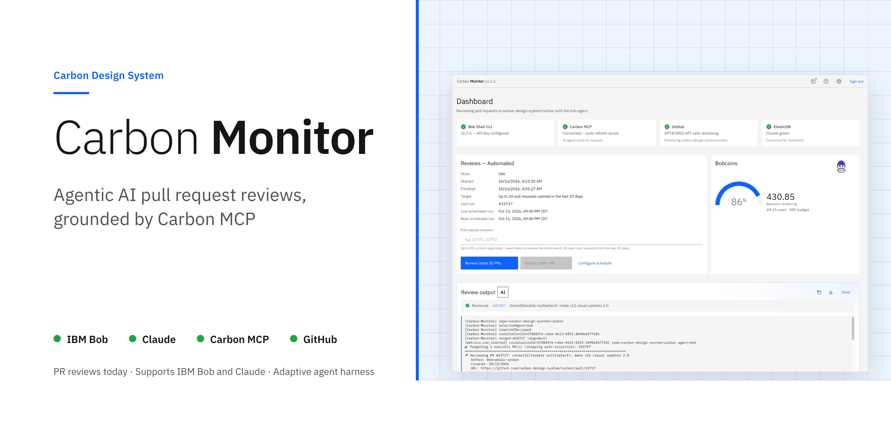
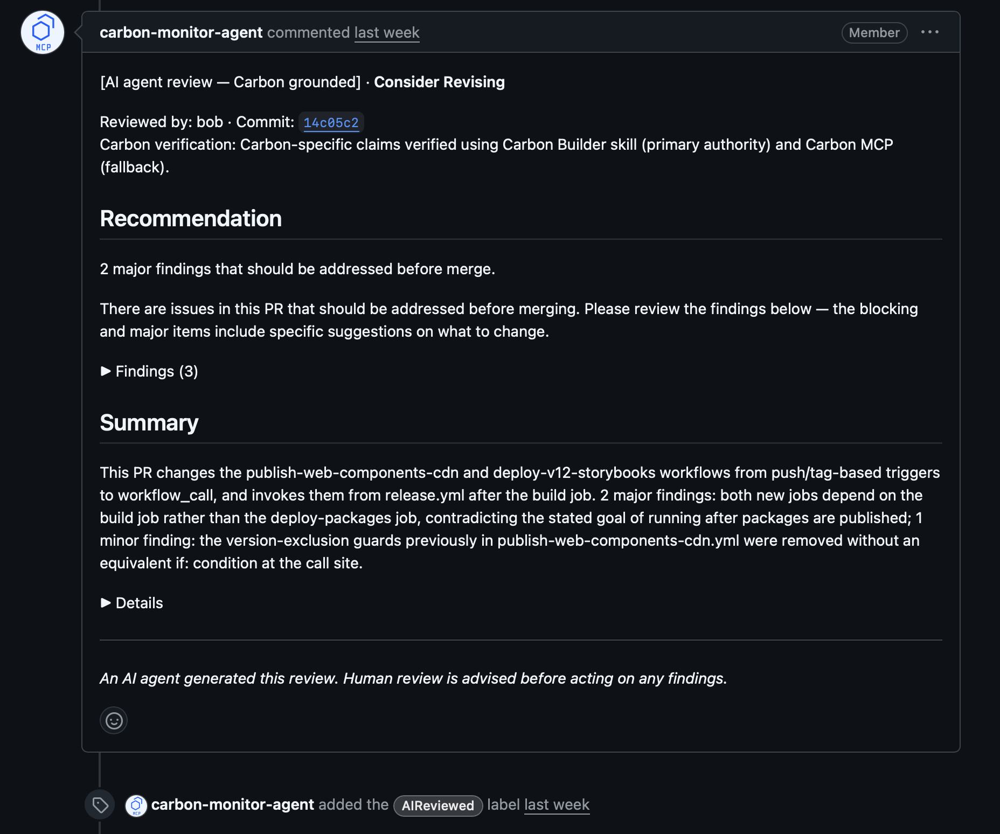
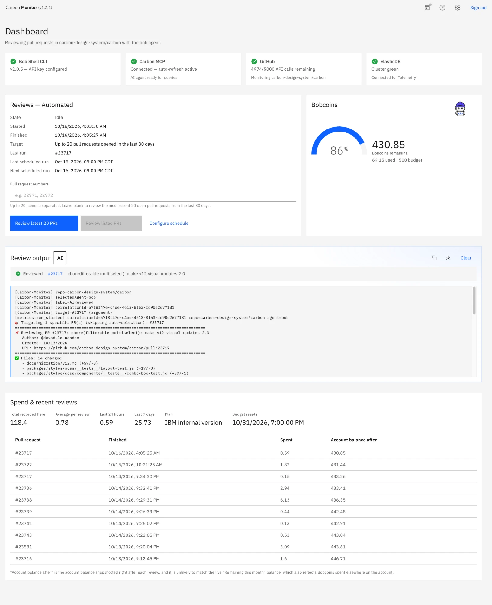
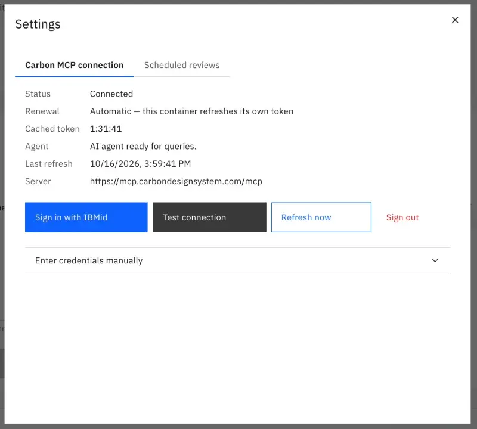
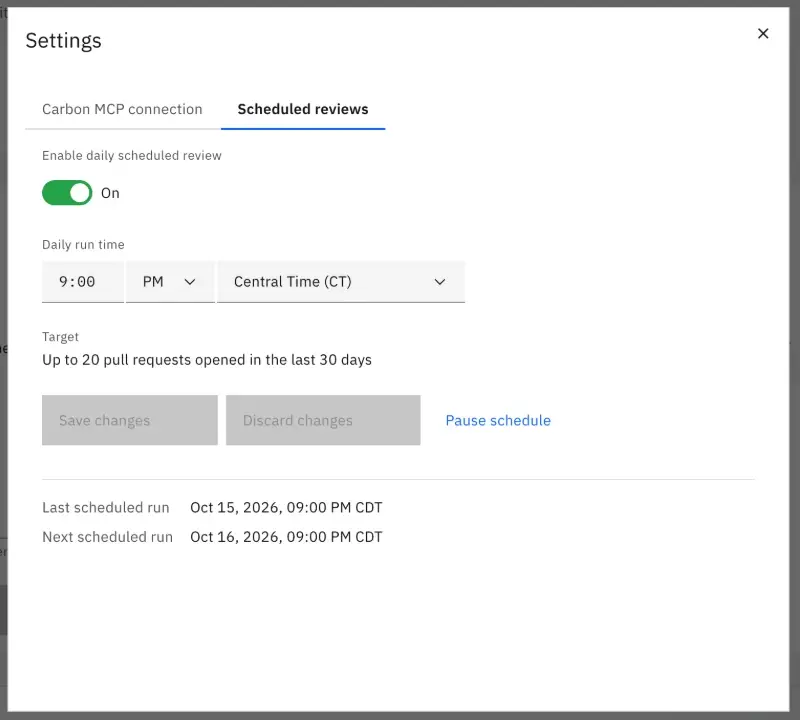
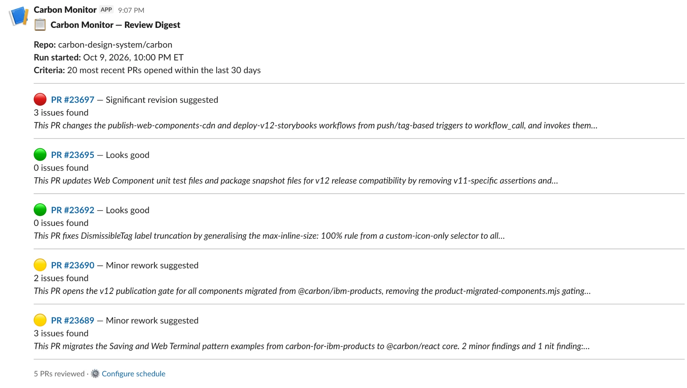
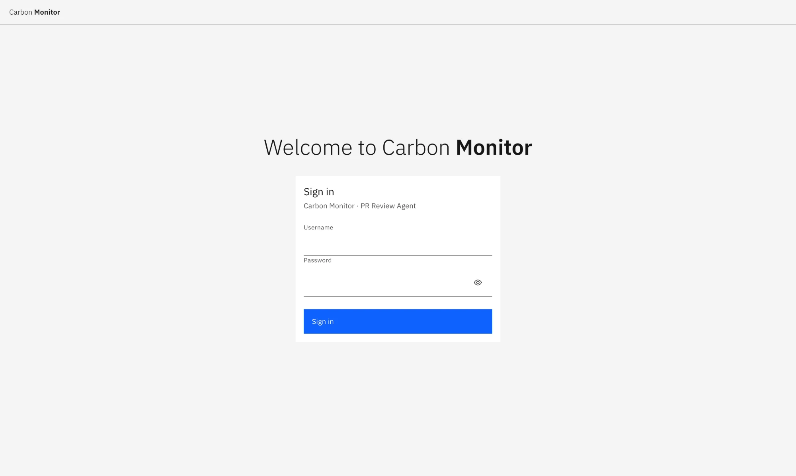

<p align="center"></p>

# Carbon Monitor

**Agentic AI pull request reviews, grounded by Carbon MCP.**

Carbon Monitor is two things. It is a working reviewer for the
`carbon-design-system/carbon` monorepo: each open pull request goes through Bob,
IBM's AI CLI agent, every Carbon-specific claim (component props, tokens, icons,
accessibility patterns) is verified against the Carbon MCP server, and the result
lands on the PR as inline comments and a summary with a recommendation. It is
also a harness for running any agent on a schedule in IBM Cloud, with cost
tracking, telemetry and a Slack report, that you can point at your own
repository or your own job.

<p align="center">
  <a href="#quick-start"><strong>Quick start</strong></a> ·
  <a href="#built-as-a-harness"><strong>Reuse the harness</strong></a> ·
  <a href="#how-a-review-works"><strong>How a review works</strong></a> ·
  <a href="#deploy"><strong>Deploy</strong></a> ·
  <a href="docs/ARCHITECTURE.md"><strong>Architecture</strong></a> ·
  <a href="docs/API.md"><strong>API</strong></a> ·
  <a href="CONTRIBUTING.md"><strong>Contributing</strong></a>
</p>

<p align="center"><a href="https://github.com/carbon-design-system/Carbon-Monitor/actions/workflows/test.yml"></a> · Apache-2.0 · Built for the Carbon Design System</p>

---

## What it does

| Stage      | What happens                                                                                                                                                                                                                                                                                                                                                                      |
| ---------- | --------------------------------------------------------------------------------------------------------------------------------------------------------------------------------------------------------------------------------------------------------------------------------------------------------------------------------------------------------------------------------- |
| **Fetch**  | Queries GitHub for open PRs, excluding drafts, bot-authored PRs (Dependabot, Renovate), PRs older than 21 days and PRs already labelled `AIReviewed`. Up to 10 PRs per run. Both limits are configurable.                                                                                                                                                                         |
| **Bundle** | Builds a temporary workspace per PR: `PR_REVIEW_REQUEST.md` (description, changed files, full unified diff), `pr.json` / `files.json` / `diff.patch`, the agent rules in `.bob/rules/01-output.md`, and the Carbon Builder skill. A `Closes #N`, `Fixes #N` or `Resolves #N` reference pulls in the linked issue (and its parent) as acceptance criteria, capped at 5,000 tokens. |
| **Review** | Runs `bob run --trust --accept-license [--team-id …] "<prompt>"` in the bundle. Bob writes a visible catalogue of every suspicious item per file, classified as Category 1 (Carbon API, needs MCP) or Category 2 (visible in the diff).                                                                                                                                           |
| **Verify** | Resolves every catalogue item. Category 1 items are checked with the Carbon Builder skill and Carbon MCP tools (`code_search`, `docs_search`, `get_charts`, `labs_search`, `code_audit`); Category 2 items from the diff alone. The parser flags runs that skipped the catalogue or hid their resolutions.                                                                        |
| **Post**   | Findings that map to a diff line become inline review comments. The rest, plus the summary and recommendation, go in one PR comment. The `AIReviewed` label is added.                                                                                                                                                                                                             |
| **Report** | Scheduled runs post a digest to Slack when `SLACK_WEBHOOK_URL` is set. Review events are written to Elasticsearch for the Kibana dashboard.                                                                                                                                                                                                                                       |

## Built as a harness

Bob is the agent. Carbon Monitor is the harness around it: everything that runs
it on a schedule in IBM Cloud, pays for it, logs it, and reports on it. The
review logic is the one part that is specific to the job, and it sits behind
named seams.

| Harness, kept as is                        | Task layer, replaced per job               |
| ------------------------------------------ | ------------------------------------------ |
| Code Engine deployment, image, secret sync | Work-item source (GitHub today)            |
| Daily schedule with budget auto-pause      | Workspace, prompt and output parser        |
| Agent runner and MCP token refresh         | Write-back and the done marker             |
| Cost ledger, Elasticsearch events, Kibana  | Event fields, digest lines, console labels |
| Slack transport, console shell, sign-in    | Health tiles for the external system       |

Three ways to make it yours:

| Path                   | What changes                                                                                                                                                    |
| ---------------------- | --------------------------------------------------------------------------------------------------------------------------------------------------------------- |
| **Another repository** | Configuration, the reviewing account's access, and optionally the rubric and the MCP server                                                                     |
| **Another job**        | The task layer, against any system: Jira, ServiceNow, Box, a database, a feed                                                                                   |
| **Another agent**      | The agent slot: install, invocation, authentication, MCP configuration, cost. Bob is the tested path; Claude Code, Codex, Gemini CLI and Copilot CLI are mapped |

The `carbon-monitor-adapt-harness` skill walks you through any of them. It
reads the harness map, asks at most ten questions, and writes a SPEC you
implement from. To use it:

1. From a clone of this repository, install the skill into your coding agent.
   No skill support? Say "Read `skills/carbon-monitor-adapt-harness/SKILL.md`
   and use it as your instructions" instead.

   ```bash
   npx skills add https://github.com/carbon-design-system/Carbon-Monitor/tree/main/skills/carbon-monitor-adapt-harness -a claude-code   # or -a bob, cursor, codex, github-copilot, gemini-cli
   ```

2. Open your agent in the clone and say "Adapt this harness to my use case"
   (in Claude Code, `/carbon-monitor-adapt-harness`). Answer the questions;
   "default" accepts a default. It writes `specs/<name>/SPEC.md`.
3. Start a fresh session and say "Implement `specs/<name>/SPEC.md`, one task
   at a time, verifying each against its acceptance criteria."

The map is [docs/HARNESS.md](docs/HARNESS.md). The skill is in [skills/carbon-monitor-adapt-harness](skills/carbon-monitor-adapt-harness/README.md); per-agent
swap notes and two finished example SPECs are in [docs/adapt-harness](docs/adapt-harness/agents/bob.md).

## What a review looks like

<p align="center"></p>

<p align="center"><em>The summary comment on a reviewed PR, followed by the AIReviewed label.</em></p>

Every review ends in one of three recommendations:

| Value                    | Meaning                                                             |
| ------------------------ | ------------------------------------------------------------------- |
| `Consider Revising`      | One or more `blocking` findings, or two or more `major` findings    |
| `Suggested Improvements` | Any `major` or `minor` finding, or review reliability was uncertain |
| `Looks Good`             | `nit`-level findings only, or no findings                           |

Each finding carries a severity:

| Severity   | Meaning                                                                        |
| ---------- | ------------------------------------------------------------------------------ |
| `blocking` | Breaks user-facing behaviour or violates an accessibility requirement          |
| `major`    | Likely to cause a visible rendering difference or runtime error                |
| `minor`    | Maintainability risk or subtle behaviour difference — not immediately breaking |
| `nit`      | Convention / hygiene — no functional consequence                               |

The inline and summary comment formats, and the reliability checks behind the
recommendation, are in [docs/REVIEW_OUTPUT.md](docs/REVIEW_OUTPUT.md).

## See it running

<p align="center"></p>

<p align="center"><em>The operator console after a clean single-PR run.</em></p>

<table>
  <tr>
    <td width="50%"></td>
    <td width="50%"></td>
  </tr>
  <tr>
    <td><em>Carbon MCP connection: sign in once with IBMid, then the container renews its own token.</em></td>
    <td><em>Scheduled reviews: one daily run, off until an operator turns it on.</em></td>
  </tr>
</table>

<p align="center"></p>

<p align="center"><em>The Slack digest posted after a scheduled run.</em></p>

<p align="center"></p>

<p align="center"><em>The console sign-in page, shown when AUTH_REQUIRED is on.</em></p>

## Who can run this

> Reading, testing and adapting the code needs nothing special: `npm ci` and
> `npm run test:all` run anywhere with Node 22.15 or later. Running a review does
> need IBM access. Bob Shell requires the IBM office network or VPN; outside it,
> requests fail with Cloudflare errors. Carbon MCP authenticates with an IBMid,
> and its token expires, so the console renews it after one **Sign in with IBMid**.
> On the GitHub side, it needs a token for the reviewing GitHub account (i.e.
> machine user), which must hold Triage on the target repo; see [docs/GITHUB_ACCESS.md](docs/GITHUB_ACCESS.md).

## Quick start

| Prerequisite        | Notes                                                                                                                                                                                                                |
| ------------------- | -------------------------------------------------------------------------------------------------------------------------------------------------------------------------------------------------------------------- |
| Node.js 24 or later | Required by Bob Shell; the code itself runs on >= 22.15.0                                                                                                                                                            |
| GitHub token        | For the reviewing GitHub account (i.e. machine user), which needs the **Triage role on the target repo**, plus Pull requests and Issues write and Contents read. See [docs/GITHUB_ACCESS.md](docs/GITHUB_ACCESS.md). |
| Bob Shell CLI       | Installed and on `PATH`                                                                                                                                                                                              |
| Carbon MCP          | Configured in Bob as a streamable-HTTP connection                                                                                                                                                                    |

```bash
git clone https://github.com/carbon-design-system/Carbon-Monitor.git
cd Carbon-Monitor
npm ci
cp .env.example .env
```

Set the two required variables in `.env`:

```bash
GITHUB_AI_AGENT_TOKEN=ghp_your_github_token_here
BOB_API_KEY=your_bob_api_key_here
```

Start the console and API, then review one PR from the CLI:

```bash
npm run build:client && npm run api   # console + API on http://localhost:3000
npm start -- --pr <number>            # review a single PR
```

`npm start` with no flag reviews every PR that passes the Fetch filter.

<details>
<summary>Configuration</summary>

The variables most deployments set. Every variable, with its default, is in
[docs/CONFIGURATION.md](docs/CONFIGURATION.md).

| Variable                    | Required | Default                | Description                                                                                                                               |
| --------------------------- | -------- | ---------------------- | ----------------------------------------------------------------------------------------------------------------------------------------- |
| `GITHUB_AI_AGENT_TOKEN`     | Yes      | —                      | GitHub PAT. Needs Pull requests + Issues write and Contents read, **and Triage on the repo** — see [GitHub access](docs/GITHUB_ACCESS.md) |
| `BOB_API_KEY`               | Yes      | —                      | Bob Shell API key. Create with Scope **Inference** in the Bob web portal — browser SSO cannot complete in a container                     |
| `GITHUB_AI_AGENT_OWNER`     | No       | `carbon-design-system` | Repository owner                                                                                                                          |
| `GITHUB_AI_AGENT_REPO`      | No       | `carbon`               | Repository name                                                                                                                           |
| `GITHUB_AI_AGENT_MAX_PRS`   | No       | `10`                   | Max PRs reviewed per run                                                                                                                  |
| `GITHUB_AI_AGENT_DAYS_BACK` | No       | `21`                   | How far back to look for PRs (days)                                                                                                       |
| `GITHUB_AI_AGENT_CLI`       | No       | `bob`                  | Worker agent. `bob` is the tested path; the others are mapped in [docs/adapt-harness](docs/adapt-harness/agents/bob.md)                   |

**Bob Shell.** Install with the official script,
`curl -fsSL https://bob.ibm.com/download/bobshell.sh | bash` (IBM network or
VPN), then run `bob trust /private/tmp` and `bob trust /path/to/Carbon-Monitor`
so Bob can use MCP tools in the review bundles.

**Carbon MCP.** Add a `carbon-mcp` entry of type `streamable-http` pointing at
`https://mcp.carbondesignsystem.com/mcp` to `~/.bob/settings/mcp.json`, then
check that `/mcp list` inside `bob` reports `carbon-mcp - Ready`.

**Carbon Builder skill.** `npm ci` (or `npm install`) places it in `.bob/skills/carbon-builder/`
if it is missing. Otherwise follow the
[Carbon Builder skill setup guide](https://carbondesignsystem.com/developing/carbon-mcp/onboarding-and-setup/#step-4:-adding-the-carbon-builder-skill).

The full `mcp.json` example is in [docs/CONFIGURATION.md](docs/CONFIGURATION.md);
token permissions are in [docs/GITHUB_ACCESS.md](docs/GITHUB_ACCESS.md).

</details>

## How a review works

```
POST /api/review/trigger          202 Accepted at once
  └─► reviewPRs()                 src/index.js
        ├─► GitHub: select open PRs, fetch diff + linked issue
        ├─► buildReviewBundle()   src/reviewBundle.js
        ├─► runAgent()            src/agentRunner.js
        │     bob run --trust --accept-license [--team-id …] "<prompt>"
        │     └─► Carbon MCP: code_search · docs_search · get_charts · labs_search · code_audit
        ├─► parseReviewOutput()   src/reviewParser.js
        ├─► post inline + summary comments, apply the AIReviewed label
        └─► Slack digest (scheduled runs only, when SLACK_WEBHOOK_URL is set)
```

Only one batch runs at a time, with up to `REVIEW_CONCURRENCY` reviews (default 2)
in flight inside it. Two agents reviewing the same PR would post the
same findings twice, so a second trigger while one is in flight gets `409` with
the running batch's details. The guard is in-process, and the Code Engine app
is pinned to one instance, so one lock covers the deployment. A review takes
minutes, longer than Code Engine's 300-second request ceiling, so the trigger
returns `202` straight away and callers poll `GET /api/review/status`. The full
contract, including request bodies, validation and authentication, is in
[docs/API.md](docs/API.md).

## Deploy

| Target                    | How                                                                                                                                                                                                                                                                                                                                                                                                                         |
| ------------------------- | --------------------------------------------------------------------------------------------------------------------------------------------------------------------------------------------------------------------------------------------------------------------------------------------------------------------------------------------------------------------------------------------------------------------------- |
| **Local**                 | `npm run build:client && npm run api` serves the console and API on one port: `PORT`, then `API_PORT`, default `3000`.                                                                                                                                                                                                                                                                                                      |
| **Container**             | `npm run build:client`, then `podman build --platform linux/amd64 -t carbon-monitor .` and `podman run -d -p 8080:8080 --env-file .env carbon-monitor`, or `docker compose up -d` with the included `docker-compose.yml`, which keeps `/workspace` in a named volume so a restart does not force a new IBMid sign-in. The image must be Debian-based: Bob Shell's `node-pty` prebuild needs glibc, so Alpine cannot run it. |
| **IBM Cloud Code Engine** | `./deploy_ce.sh` reads credentials and the deployment target (`REGION`, `RESOURCE_GROUP`, `PROJECT`, `NAMESPACE`) from `.env`, syncs the secret, builds, pushes and deploys. The app runs at min-scale 1 and max-scale 1: the Carbon MCP refresh timer needs an instance that never scales to zero, and the rotating refresh token needs exactly one writer.                                                                |

After the first deploy, open the console and press **Sign in with IBMid** once.
The deployment topology, ordering rules and image layout are in
[docs/ARCHITECTURE.md §8](docs/ARCHITECTURE.md#8-deployment).

### Console sign-in

Sign-in is off in code but **on in `.env.example` and in the `deploy_ce.sh`
default**. With `AUTH_REQUIRED=true`, the console shows a sign-in page that
accepts `CONSOLE_USERNAME` / `CONSOLE_PASSWORD`, scripts authenticate with
`Authorization: Bearer <API_SECRET>`, and `SESSION_SIGNING_KEY` should be set so
a restart does not sign everyone out. With it off, anyone with the app's URL can
read status and trigger a review. See
[docs/ARCHITECTURE.md §5](docs/ARCHITECTURE.md#5-authentication-model).

## Operate

| Feature               | What it does                                                                                                                                                                               |
| --------------------- | ------------------------------------------------------------------------------------------------------------------------------------------------------------------------------------------ |
| **Operator console**  | Status tiles for Bob Shell, Carbon MCP, GitHub and Elasticsearch that say what is wrong, a Reviews panel to run the latest PRs or a named list, and a live log of the current or last run. |
| **Scheduled reviews** | One daily run, configured in **Settings → Scheduled reviews**. Off on a fresh install. `npm start` also runs a single pass and exits, so an external scheduler can drive it.               |
| **Slack digest**      | Set `SLACK_WEBHOOK_URL` to a Slack incoming webhook. The digest fires after scheduled runs only; runs started from the console do not post.                                                |
| **Kibana dashboard**  | Review metrics from Elasticsearch, when `ES_URL` is set. Setup is in [kibana/README.md](kibana/README.md).                                                                                 |
| **Bobcoins tracking** | Shows the Bob balance and per-review spend. Scheduled reviews pause themselves, and alert Slack, when the balance falls below `BOB_CREDITS_LOW_PCT` (default 10%).                         |

## Documentation

| Document                                                                             | Covers                                                                                           |
| ------------------------------------------------------------------------------------ | ------------------------------------------------------------------------------------------------ |
| [docs/ARCHITECTURE.md](docs/ARCHITECTURE.md)                                         | Container image, Carbon MCP token refresh, authentication, Code Engine deployment, module map    |
| [docs/HARNESS.md](docs/HARNESS.md)                                                   | Harness versus task layer, every extension point, the agent slot, the names that change          |
| [skills/carbon-monitor-adapt-harness](skills/carbon-monitor-adapt-harness/README.md) | The skill that interviews you and writes a SPEC for your own repository, job or agent            |
| [docs/GITHUB_ACCESS.md](docs/GITHUB_ACCESS.md)                                       | The reviewing GitHub account (i.e. machine user), its token permissions, and why it needs Triage |
| [docs/CONFIGURATION.md](docs/CONFIGURATION.md)                                       | Environment variables, Bob Shell, Carbon MCP and Carbon Builder setup                            |
| [docs/API.md](docs/API.md)                                                           | REST endpoints and the full review trigger contract                                              |
| [docs/REVIEW_OUTPUT.md](docs/REVIEW_OUTPUT.md)                                       | Inline and summary comment formats, recommendations, reliability checks                          |
| [docs/INLINE_COMMENTS.md](docs/INLINE_COMMENTS.md)                                   | How findings are mapped to diff lines                                                            |
| [docs/TOKEN_USAGE_TRACKING.md](docs/TOKEN_USAGE_TRACKING.md)                         | Token usage estimates in the summary comment                                                     |
| [docs/MCP_TOKEN_REFRESH.md](docs/MCP_TOKEN_REFRESH.md)                               | Manual Carbon MCP token refresh, the fallback to IBMid sign-in                                   |
| [kibana/README.md](kibana/README.md)                                                 | Kibana dashboard setup                                                                           |
| [CONTRIBUTING.md](CONTRIBUTING.md)                                                   | Setup, tests and pull request guidelines                                                         |
| [SECURITY.md](SECURITY.md)                                                           | Reporting a vulnerability                                                                        |

## Troubleshooting

**Bob not found in PATH.** Install it with
`curl -fsSL https://bob.ibm.com/download/bobshell.sh | bash`, then confirm with
`which bob`.

**Carbon MCP not connected.** Run `/mcp list` inside `bob`; it should show
`carbon-mcp - Ready`. If not, check `~/.bob/settings/mcp.json`, sign in with
IBMid from the console, or call `POST /api/mcp/refresh`.

**No PRs to review.** Expected when every open PR already has the `AIReviewed`
label, or none was opened within the `DAYS_BACK` window.

**Keep artifacts for debugging.** Run `GITHUB_AI_AGENT_KEEP_ARTIFACTS=true npm start`.
The bundle path is printed; it holds `agent-output.txt` (Bob's full response), `agent-events.ndjson`
(Bob's raw event stream) and `agent-stderr.txt`.

## Development

### Adding review rubric checks

The review prompt in [`src/reviewPrompt.js`](src/reviewPrompt.js) (`buildReviewPrompt`) contains the full numbered rubric Bob follows. Adding a new check means appending a numbered rule to the prompt — no other files need to change.

### Changing the comment format

Summary comment rendering is in [`formatSummaryComment`](src/reviewPrompt.js) and inline comment rendering in [`formatInlineComment`](src/reviewPrompt.js).

### Adjusting finding filters

`reviewParser.js` contains `filterUnverifiedCarbonFindings` and `computeRecommendation`. The recommendation logic is in `computeRecommendation`.

---

## Build with us

- **Issues:** report bugs and propose features in [GitHub issues](https://github.com/carbon-design-system/Carbon-Monitor/issues).
- **Pull requests:** welcome. Read [CONTRIBUTING.md](CONTRIBUTING.md) first.
- **Security:** report vulnerabilities privately, as described in [SECURITY.md](SECURITY.md).
- **License:** Apache-2.0. See [LICENSE](LICENSE).
